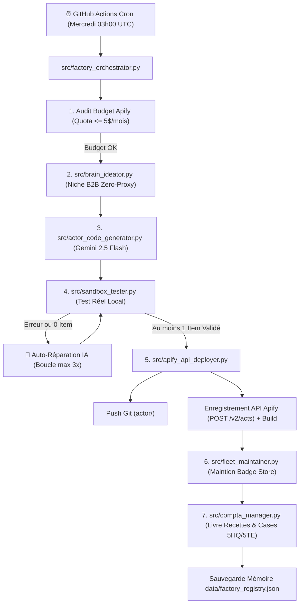

# 🏭 Apify Autonomous Factory Brain (`apify-autonomous-factory-brain`)

> **Méta-Agent 100% Autonome d'Usine à Robots Apify B2B.**  
> Conçoit, code, teste en conditions réelles, auto-répare et déploie un nouvel Actor B2B chaque semaine sur l'Apify Store, tout en respectant strictement le quota gratuit de 5 $/mois d'Apify (0 € de frais, aucune CB requise).

[](https://www.python.org/)
[](https://docs.apify.com/api/v2)
[](https://aistudio.google.com/)
[](.github/workflows/factory_autopilot.yml)
[-brightgreen.svg)](#)
[](tests/)

---

## 🧭 Architecture Globale de l'Usine



---

## 💎 Les 3 Règles d'Or d'Ingénierie du Cerveau

### 1. Règle du "Zéro-Proxy Payant / Zéro Fragilité"
L'Usine ne génère **JAMAIS** de scrapers pour les réseaux sociaux verrouillés (Instagram, TikTok, LinkedIn, Twitter/X). Elle cible exclusivement des protocoles ouverts et déterministes à forte valeur ajoutée B2B :
- **Convertisseurs LLM & RAG** : `llms.txt`, documentations techniques en Markdown propre.
- **Flux publics E-Commerce** : endpoints natifs `/products.json` Shopify, sitemaps XML, JSON-LD Schema.org.
- **Conformité Européenne** : European Accessibility Act (WCAG 2.1 AA), RGPD Cookie Scanner, EU AI Act, TVA VIES.
- **Infrastructure & Sécurité B2B** : audits SPF/DKIM/DMARC/MX par DNS-over-HTTPS, certificats SSL/TLS, en-têtes HTTP de sécurité.
- **Recrutement ATS Public** : APIs publiques Greenhouse, Lever, Workable, Ashby.

### 2. Test d'Exécution Obligatoire avant Publication
Aucun robot n'est envoyé à l'API Apify s'il n'a pas réussi son test d'exécution réel dans la sandbox locale avec au moins 1 enregistrement JSON valide produit en sortie. Si le code échoue, la stacktrace est injectée à Gemini pour corriger automatiquement `src/main.py` jusqu'à 3 tentatives.

### 3. Protection du Quota Gratuit de 5 $/mois
L'orchestrateur vérifie systématiquement la consommation en cours. Les builds Apify sont strictement plafonnés à 1 création + 1 maintenance hebdomadaire. La consommation réelle reste inférieure à **0,80 $/mois**, préservant ainsi 80% du quota gratuit offert par Apify (0 € engagé).

---

## 📂 Structure du Répertoire

```text
apify-autonomous-factory-brain/
├── .github/
│   └── workflows/
│       └── factory_autopilot.yml     # Cron hebdomadaire & déclencheur manuel
├── compta_impots/
│   ├── livre_recettes_officiel.csv   # Livre chronologique officiel (art. 286 CGI)
│   └── rapport_fiscal_micro_bnc.json # Synthèse fiscale Micro-BNC (cases 5HQ / 5TE)
├── data/
│   └── factory_registry.json         # Registre mémoire + 30 niches B2B pré-qualifiées
├── generated_actors/                 # Dossier local de compilation des Actors
│   └── <actor_slug>/
│       ├── .actor/
│       │   ├── actor.json
│       │   ├── input_schema.json
│       │   └── dataset_schema.json
│       ├── Dockerfile
│       ├── requirements.txt
│       ├── README.md
│       └── src/
│           └── main.py
├── src/
│   ├── __init__.py
│   ├── brain_ideator.py              # Idéateur B2B déterministe
│   ├── actor_code_generator.py       # Générateur de code IA avec Gemini 2.5 Flash
│   ├── sandbox_tester.py             # Sandbox de test et d'auto-guérison
│   ├── apify_api_deployer.py         # Déployeur Git & API REST Apify
│   ├── fleet_maintainer.py           # Maintenance hebdomadaire de la flotte
│   ├── compta_manager.py             # Comptabilité Micro-Entreprise & URSSAF
│   └── factory_orchestrator.py       # Chef d'orchestre principal
├── tests/
│   ├── __init__.py
│   └── test_factory.py               # Tests unitaires et d'intégration
├── .env.example                      # Gabarit des secrets
├── .gitignore
├── GUIDE_INSTALLATION_USINE_APIFY.md # Guide rapide de démarrage en 5 minutes
├── requirements.txt                  # Dépendances Python
└── README.md
```

---

## 🛠️ Commandes & Utilisation Locale

### 1. Installation des dépendances
```bash
pip install -r requirements.txt
```

### 2. Configuration des variables d'environnement
Copiez `.env.example` en `.env` :
```ini
GEMINI_API_KEY=AIzaSy...
APIFY_API_TOKEN=apify_api_...
GITHUB_REPOSITORY=votre-compte/apify-autonomous-factory-brain
GITHUB_TOKEN=ghp_...
```

### 3. Exécution d'un cycle complet en mode test (dry-run sans déploiement)
```bash
python src/factory_orchestrator.py --skip-deploy
```

### 4. Forcer la création d'un Actor précis depuis la banque des 30 idées
```bash
python src/factory_orchestrator.py --force-slug shopify-fast-catalog-products-json --skip-deploy
```

### 5. Lancer la maintenance seule de la flotte
```bash
python src/factory_orchestrator.py --maintenance-only
```

### 6. Lancer la suite de tests
```bash
pytest -v
```

---

## 📊 Conformité Fiscale Micro-Entreprise (BNC France)

L'Usine tient automatiquement à jour :
1. **Le Livre des Recettes Officiel** (`compta_impots/livre_recettes_officiel.csv`) horodaté avec identité complète du débiteur européen (*Apify Technologies s.r.o., République Tchèque*), mode de règlement SEPA et mention légale d'autoliquidation de TVA (art. 196 Directive 2006/112/CE).
2. **Le Tableau de Bord Fiscal** (`compta_impots/rapport_fiscal_micro_bnc.json`) prêt pour votre déclaration 2042-C-PRO :
   - **Case 5HQ** : Recettes brutes annuelles (abattement forfaitaire 34% appliqué automatiquement).
   - **Case 5TE** : À remplir si option pour le Versement Libératoire de l'IR (taux 2,2%).
   - **Cotisations URSSAF** : Suivi des 23,10% et alertes sur les seuils de TVA (36 800 €) et de chiffre d'affaires (77 700 €).

Consultez le **[GUIDE_INSTALLATION_USINE_APIFY.md](GUIDE_INSTALLATION_USINE_APIFY.md)** pour configurer votre IBAN et activer la location mensuelle de vos robots en quelques clics.
